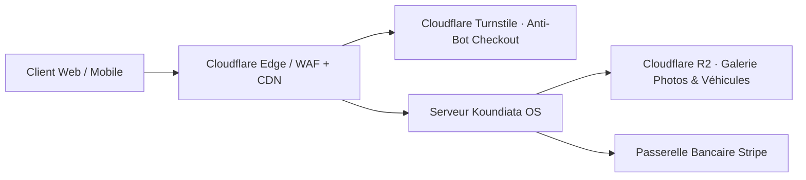

# Intégration & Déploiement Cloudflare

Ce guide récapitule l'utilisation de Cloudflare avec l'application **Koundiata OS**.

---

## 1. Tunnel Cloudflare (En cours d'exécution)

Un tunnel Cloudflare sécurisé (`cloudflared`) a été déployé pour exposer l'application locale (`http://localhost:3847`) directement sur Internet en **HTTPS sécurisé**.

### 🔗 Liens d'accès public en direct :
* **Boutique publique :** [https://across-steady-facial-merchandise.trycloudflare.com](https://across-steady-facial-merchandise.trycloudflare.com)
* **Theme Studio & Dashboard :** [https://across-steady-facial-merchandise.trycloudflare.com/studio](https://across-steady-facial-merchandise.trycloudflare.com/studio)
* **Webhook Stripe :** `https://across-steady-facial-merchandise.trycloudflare.com/api/stripe/webhook`

> **Note :** Ce tunnel permet de tester le site immédiatement sur smartphone, de le partager à des clients ou investisseurs, et de recevoir les webhooks Stripe en direct sans configuration de routeur ou de pare-feu.

### Relancer le tunnel à tout moment :
```bash
cd koundiata
npm run tunnel
```

---

## 2. Configuration des Webhooks Stripe avec Cloudflare

Pour tester les paiements réels avec Stripe en direct :
1. Rendez-vous sur votre dashboard Stripe > Développeurs > Webhooks.
2. Ajoutez un endpoint avec l'URL de votre tunnel :
   `https://across-steady-facial-merchandise.trycloudflare.com/api/stripe/webhook`
3. Sélectionnez les événements :
   - `checkout.session.completed`
   - `checkout.session.expired`
4. Renseignez la clé secrète dans votre fichier `koundiata/.env.local` :
   ```env
   STRIPE_SECRET_KEY=sk_test_...
   STRIPE_WEBHOOK_SECRET=whsec_...
   NEXT_PUBLIC_SITE_URL=https://across-steady-facial-merchandise.trycloudflare.com
   ```

---

## 3. Architecture Cloudflare Recommandée pour la Vente B2B

Lors de la cession du logiciel à une entreprise cliente (concessionnaire, marque de cosmétique) :



1. **WAF & Rate Limiting** : Activer la protection anti-DDoS et limiter à 5 tentatives/minute les soumissions sur `/commande` et `/api/stripe` pour contrer la fraude aux tests de cartes bleues.
2. **Cloudflare Turnstile** : Alternative gratuite, invisible et conforme RGPD à reCAPTCHA.
3. **Cloudflare R2 (Stockage S3 sans frais de bande passante)** : Idéal pour les concessions automobiles hébergeant des milliers de photos HD de véhicules d'occasion.
